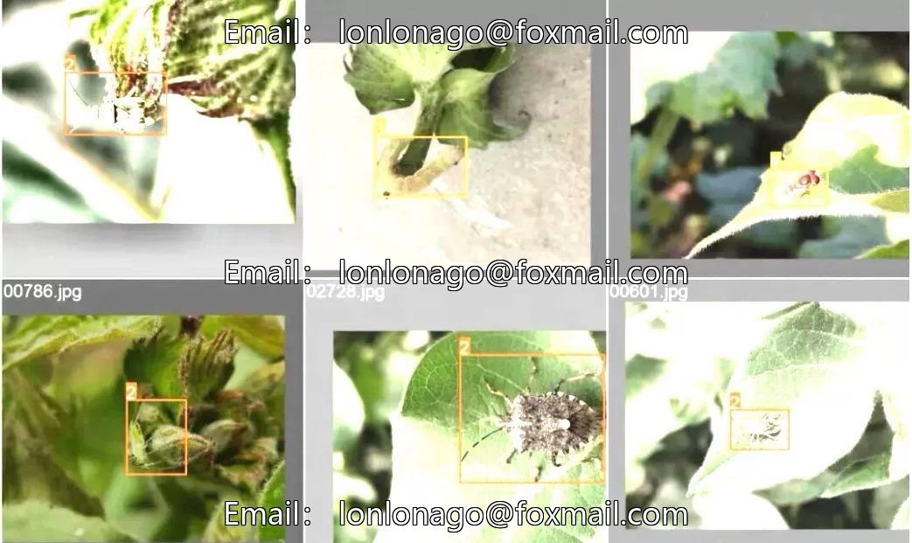
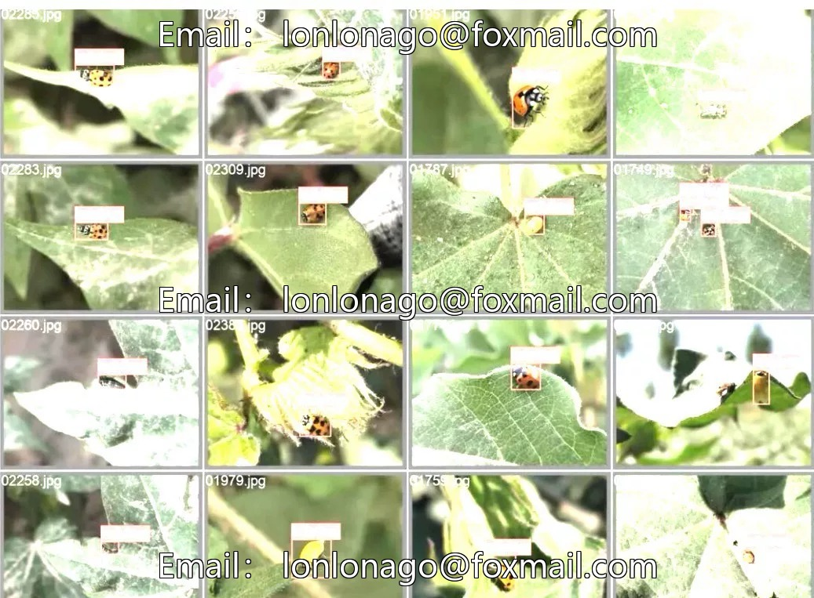
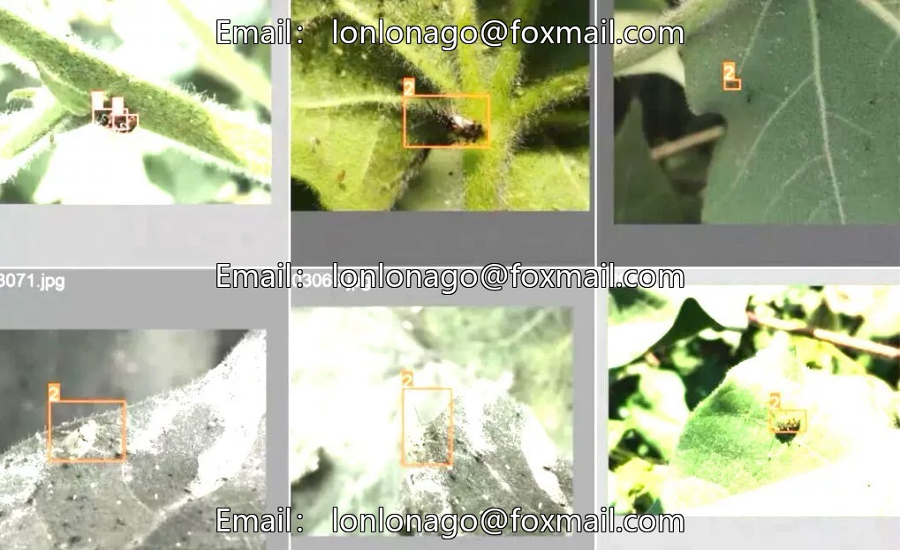

# Intelligent Agriculture Pest Identification Dataset, Issue 10187, containing 2900 images

## Body

Intelligent Agriculture Pest Identification Dataset, Issue 10187, comprising 2900 images, covering 6 types of pests: grasshoppers, ladybugs, bed bugs, moths, aphids, and leafcutting ants. Suitable for the development of automatic pest identification systems in agriculture, as well as training and optimization of insect target detection models.

The dataset consists of image files and annotation files, with the annotation format being TXT. It supports YOLO series models (such as YOLOv5, YOLOv7, YOLOv8, etc.), which can be directly used in a Python environment. The formats of VOC and COCO can be converted.

Virtual materials, once sold, are non-refundable.
Interested friends, click "I want" to proceed.

## Images

## Payment

Here is a pay link on Stripe ( https://buy.stripe.com/3cs8yP7sY87d0vu9AB ). Please contact me lonlonago@foxmail.com after funding $89, and I will send you a complete data files , thank you!

